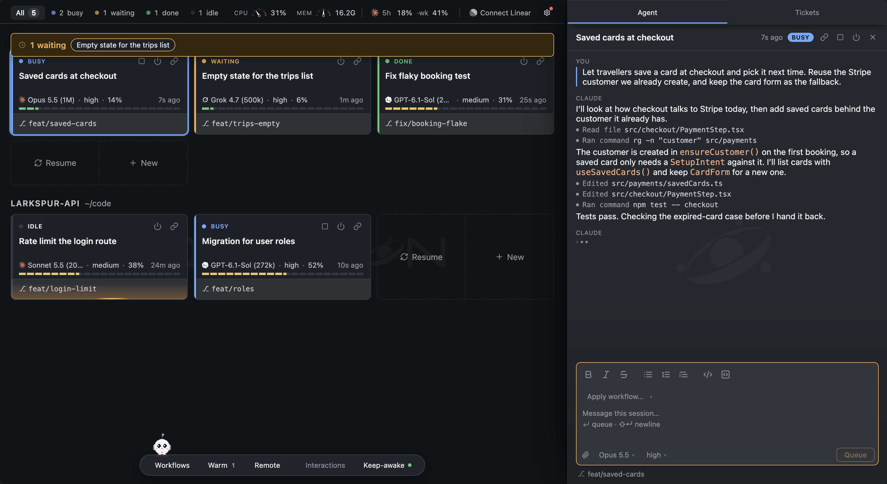
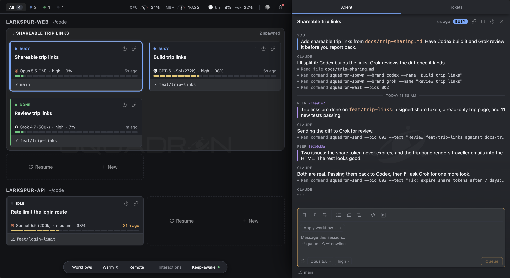
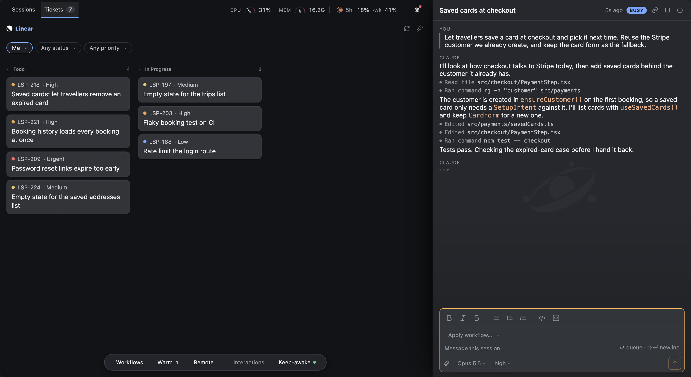
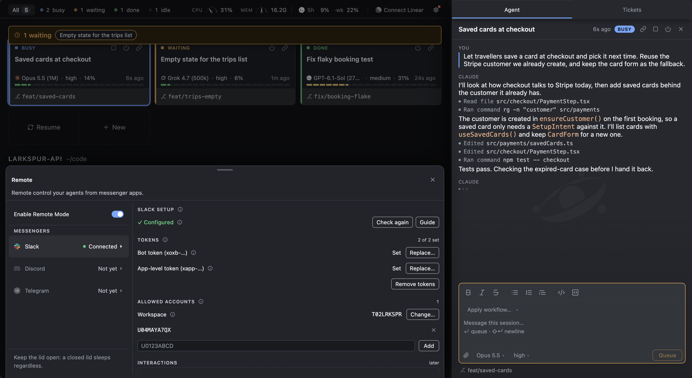
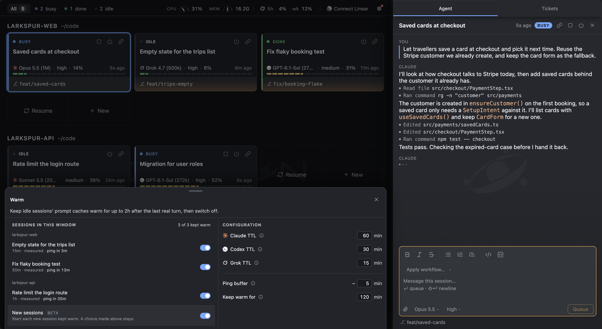

  

  
  

  
  
  

  
  
  

Run Claude Code, Codex and Grok sessions from one VS Code panel. See at a
glance which ones are working and which are waiting on you, grouped by the
folder each one runs in, then open any conversation to read it or reply.

Works in VS Code and editors built on it. Needs macOS for now; Windows support
is planned.

## Requirements

- One of these, installed and signed in:
  - **[Claude Code](https://code.claude.com/docs/en/quickstart):** `curl -fsSL https://claude.ai/install.sh | bash`
  - **[Codex](https://developers.openai.com/codex/cli/):** `npm i -g @openai/codex`
  - **[Grok](https://x.ai/docs/build/overview):** `curl -fsSL https://x.ai/cli/install.sh | bash`
- VS Code ≥ 1.95 (the extension also works in Antigravity via Open VSX)
- macOS, Apple Silicon or Intel. Keep-awake, the machine gauges and the
  dev-server ports read macOS tools (`caffeinate`, `pmset`, `vm_stat`, `lsof`).
  Windows support is planned; Windows helper features require x64 and
  .NET Framework 4.8.1 or later.

## What you can do

- Run agents in your IDE with your Claude Code, Codex or Grok subscription.
- Follow agent cards with live status and sound cues when agents need you or finish.
- Attach files and images in chat, and browse past attachments and agent-created artifacts.
- Answer questions and permission prompts in a unified modal UI across models.
- Build multi-step workflows with agents across models, and sequence workflows through step instructions.
- Answer your sessions from your phone through Slack, with [Remote](#remote-answer-sessions-from-your-phone).
- Keep an idle session's prompt cache warm, so coming back to it doesn't resend the whole conversation, with [Warm](#warm-keep-a-sessions-cache-warm) (experimental).
- Keep your Mac awake while sessions work, or while Remote is on. **Keep-awake** on the bar at the bottom of the board shows what is holding it and for how long.
- Sign in to each CLI from **Settings** (the gear), see each account's plan usage beside it, and pick the model and effort new sessions start on.
- Turn on the mascot, a small pixel chick that sits on the bar and flies to the card where something happens. Experimental and off by default: Settings → General → Mascot.
- And more…

Note that the extension only shows sessions started in it; TUI sessions are not supported as a product decision (also too much hassle to support).

## Agents that work together

A session can start other sessions, send them messages and wait for their
answers, even when they run a different CLI. Ask Claude to have Codex build a feature and Grok review
it: Claude starts both, hands each its task, and reads what they send back.

To let agents start and message other sessions, turn on Orchestration in
Agents on the bottom hub (`squadron.orchestrators.enabled`). It's off by
default, and while it's off every session command that acts (message, start,
end, rename, warm, wait, step, Remote files) refuses. Listing sessions and
models still works.

Enabling it also installs three skills for your CLIs: `squadron` for session
commands, `squadron-workflow-builder` for creating reusable workflows, and
`squadron-heavy-runs`, which has sessions take turns on test suites and builds
instead of running them all at once.

The extension supplies you with 2 example workflows to play with, modify it per your work preferences as you go.

## Browse your Linear backlog

Click **Tickets** to browse your Linear backlog by status while keeping your
conversation open. Filter by assignee, status or priority, and click a ticket
identifier to open it in Linear.

## Remote: answer sessions from your phone

Remote connects this machine's sessions to Slack. When a session asks a
question or wants a permission, finishes, fails or stops early, you're
mentioned in that session's own Slack thread. Reply in the thread to answer
it, or press Deny or End. `/squadron new` starts a job in a folder, model and
effort you pick, and `/squadron list` shows what's running. @mention the bot in
a channel thread to start a job there, with the thread's earlier messages handed
to the agent.

Click **Remote** on the bar at the bottom of the board to set it up. The guide
walks you through making the Slack app from its manifest. Paste the app's two
tokens, add your Slack member id under Allowed accounts, press **Check**, then
turn on **Enable Remote Mode**.

Only the accounts you allow are heard, and a permission can be denied from your
phone but never allowed. Remote runs in one window at a time, comes back after a
reload, and keeps your Mac awake while it's on (unless Keep-awake is off or the
Mac is on battery).

## Warm: keep a session's cache warm

Experimental. Each CLI keeps your conversation cached for a while after a turn:
about an hour for Claude, 35 minutes for Codex and 10 for Grok. Warm sends an
idle session one short ping just before that runs out, for up to two hours
after its last real turn, so picking the session back up doesn't pay to resend
the whole context. A warmed card has a copper edge, and an ember runs along its
footer while a ping is out.

Click **Warm** on the bar to switch it per session, and to set each CLI's cache
lifetime, how early to ping and for how long. Turn on
`squadron.warmCache.enabled` to have new sessions start warmed. Pings spend
tokens, and the cache isn't guaranteed to be reused.

## Getting started

1. Install Squadron from the
   [VS Code Marketplace](https://marketplace.visualstudio.com/items?itemName=peterfangtw.squadron),
   or from [Open VSX](https://open-vsx.org/extension/peterfangtw/squadron) if
   you use Antigravity, Cursor, VSCodium or another VS Code fork.
2. Sign in to Claude Code, Codex, or Grok. You need at least one. Squadron uses
   the CLI you already have and never installs one for you.
3. Run **Squadron: Show Sessions Overview** from the Command Palette, or click
   the Squadron icon in the editor's title bar.
4. If Squadron can't find your CLI, click **Log in** at the top of the panel and
   use **Set path**. This happens a lot when the editor was opened from the
   Dock, because it doesn't pick up your shell's `PATH`.

## Settings

Everything is under `squadron.*` in Settings. The ones worth knowing:

| Setting | What it does |
|---|---|
| `squadron.orchestrators.enabled` | Orchestration: lets sessions act on each other through every session command that writes. Off by default. |
| `squadron.model` | Model new sessions start on. Empty lets the CLI pick. |
| `squadron.sound.level` | Sounds for finished and waiting sessions: `off`, `quiet`, `normal` (default) or `loud`. |
| `squadron.cafe.enabled` | Keeps your Mac awake while sessions work. On by default. |
| `squadron.warmCache.enabled` | Starts new sessions with Warm on. Experimental, off by default. |
| `squadron.mascot.enabled` | Shows the mascot on the board. Experimental, off by default. |
| `squadron.skipPermissions.enabled` | Starts sessions with `--dangerously-skip-permissions`, so they edit files and run commands without asking. Off by default. |

## Platforms

macOS is supported. Linux is untested. Windows doesn't work yet: sessions may
never appear.

## Roadmap

Ideas we're working toward, in no particular order:

- **Workflow Editor UI Refine**
- **Workflow v3:** dynamic workflows (model-agnostic), continuous/routine workflows.
- **Gemini support:** when I have money to get access to Gemini 4...
- **Implementation of Decision layers:** Jev or other decision models, for workflow routing or automate choices, idk, still early in ideation
- **Tickets UI rework:** TBD. A better board for your Linear tickets; probably will add basic in-app task tracking as well
- **Board UI rework:** TBD. Better grouping UI for agent sessions on the board.
